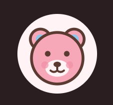

# 🧸 Portafolio de Proyecto Web: CuddleMe

**Estudiante:** [Paola Jezabel Martinez Moreno]
**Fecha:** [Viernes 16 de octubre de 2026]
**Enlace al Sitio Web (Vercel):** https://cuddlememain.vercel.app/
**Repositorio GitHub:** https://github.com/pm2013952-gif/cuddleme_main.gito

---

## 1. Identidad de Marca y Producto

### 🧸 Ficha del Producto

* **Nombre Comercial:** CuddleMe
* **Descripción:** CuddleMe crea peluches suaves hechos a pedido. Cada cliente diseña el suyo en la página: elige el tipo de oso (clásico, panda, polar o dorado), el color, las orejas, las patitas, los accesorios, la ropita, el nombre y un mensaje especial que llega en una tarjeta junto con el peluche. Los ojos son bordados para que sean seguros para niños pequeños.
* **Público Objetivo:** Familiares y amigos que buscan un regalo con significado: padres y abuelos de niños de 0 a 10 años, y también jóvenes y adultos que quieren sorprender a su pareja o a un amigo en cumpleaños, aniversarios, graduaciones o San Valentín.
* **Propuesta de Valor:** Un peluche único porque lo diseñas tú. No regalas un objeto cualquiera: regalas un compañero con nombre, estilo y un mensaje propio.
* **Frase de marca:** "Un abrazo que puedes personalizar."

### 🎨 Diseño Visual

* **Logotipo:** la cara de un osito con mejillas sonrojadas y orejas de dos colores. Usa formas redondas, sin esquinas, para transmitir suavidad y ternura.



* **Paleta de Colores:**

| Color | Código HEX | Uso en el Sitio |
| :--- | :--- | :--- |
| Rosa algodón (dominante) | `#F7A8B8` | Encabezado de tablas, hero, botones y bordes de acento. Representa ternura y cariño. |
| Café cacao (texto) | `#5A3A31` | Textos, contornos y botones. Transmite calidez y se lee bien sobre colores claros. |
| Azul cielo (acento) | `#8EC5E8` | Hovers, foco del teclado y detalles. Da calma y equilibra la dulzura del rosa. |
| Blanco rosado (fondo) | `#FFF3F6` | Fondo general del sitio en modo claro. |

El sitio incluye además **modo oscuro**, que cambia el fondo a un café profundo y el texto a rosa pálido, manteniendo el rosa y el azul para que la marca se reconozca en ambos modos.

* **Demostración del Carousel (Bootstrap):** carrusel con efecto *crossfade* (`carousel-fade`), indicadores, flechas y un botón de pausa para accesibilidad. Muestra cinco peluches: clásico con lazo, panda estudioso, polar con bufanda, dorado con corona y lila con orejas de gatito.


---

## 2. Investigación Técnica

Resumen informativo de las subpáginas creadas:

1. **JavaScript (Vanilla):** es el lenguaje que da comportamiento a la página. HTML aporta la estructura, CSS el estilo y JS la interacción. Se explican las variables (`let`, `const`), las funciones y los eventos (`click`, `mouseover`) con `addEventListener`, y se incluye un ejemplo funcional: un contador de abrazos.
2. **jQuery:** librería lanzada en 2006 para escribir menos código y resolver las diferencias entre navegadores. Su sintaxis gira en torno a `$('selector').accion()`. Ventajas: sintaxis corta y efectos listos (`fadeIn`, `slideToggle`). Desventajas: peso extra y que JavaScript moderno (`querySelector`, `classList`, `fetch`) ya cubre casi todo. La página incluye una tabla comparativa con JS vanilla y demos de efectos.
3. **JSON:** formato de texto de pares clave-valor, ligero y legible, estándar para intercambiar datos entre aplicaciones y servidores. Las claves y textos van con comillas dobles. `JSON.stringify` convierte un objeto en texto y `JSON.parse` hace lo contrario; la página tiene un validador interactivo y un ejemplo de `fetch`.
4. **Web Hosting y Dominios:** el hosting guarda los archivos en un servidor siempre encendido (compartido, VPS, nube). Vercel publica sitios estáticos desde GitHub en una red global (CDN), con URL pública, HTTPS y redespliegue automático en cada `git push`. Se explican las partes de un dominio (subdominio, dominio y TLD) y la propagación DNS, que depende del TTL y puede tardar hasta 48 horas.

**Página extra:** *15 IA de Google*, con filtros por categoría, buscador y una ventana modal (Bootstrap) con los pasos de uso de cada herramienta y una idea aplicada a CuddleMe.

**Cuestionario:** módulo de repaso con preguntas de opción múltiple y verdadero/falso sobre los temas del sitio. Muestra retroalimentación inmediata y un resultado final.

---

## 3. Integraciones Especiales

### 💬 Formulario de Contacto + Webhook de Discord

Explicación técnica del funcionamiento:

1. El usuario completa el formulario (Nombre, Correo y Mensaje) en la web.
2. Al presionar "Enviar", JavaScript evita la recarga de la página y ejecuta una petición asíncrona `fetch` (método `POST`, con el cuerpo en JSON) hacia la URL del Webhook de Discord.
3. Discord recibe el mensaje y la notificación aparece de inmediato en el canal designado.

```js
fetch(WEBHOOK_URL, {
  method: 'POST',
  headers: { 'Content-Type': 'application/json' },
  body: JSON.stringify({ content: `**Nombre:** ${nombre}\n**Correo:** ${correo}\n**Mensaje:** ${mensaje}` })
});
```

---

## 4. Anexos y Evidencias Gráficas
### Anexo 1: Integración con Discord (Formulario vs. Recepción)

![Formulario y notificación en Discord]

### Anexo 2: Despliegue Exitoso en Vercel

![Panel de Vercel con estado Ready]

### Anexo 3: Diseño Responsive y Bootstrap

![Vista móvil desde DevTools]

### Anexo 4: Cuestionario Interactivo en Funcionamiento

![Cuestionario con preguntas respondidas]
### Anexo 5: Estructura del Repositorio en GitHub

![Estructura del repositorio]


---

## 5. Conclusiones y Autoevaluación

* **Desafíos enfrentados:** [Escribe aquí tus retos reales. Por ejemplo: dibujar el peluche con SVG generado desde JavaScript, hacer que el menú y la rejilla se adapten al móvil, configurar el webhook sin exponer la URL, o implementar el modo oscuro.]
* **Aprendizajes clave:** [Escribe aquí lo que consolidaste. Por ejemplo: uso de componentes de Bootstrap (navbar, carousel, modal, rejilla), manipulación del DOM con JavaScript, consumo de APIs con `fetch` y JSON, despliegue continuo con GitHub y Vercel, y documentación técnica en Markdown.]
